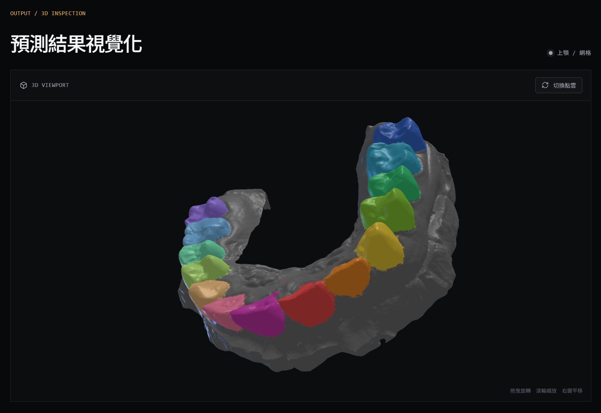
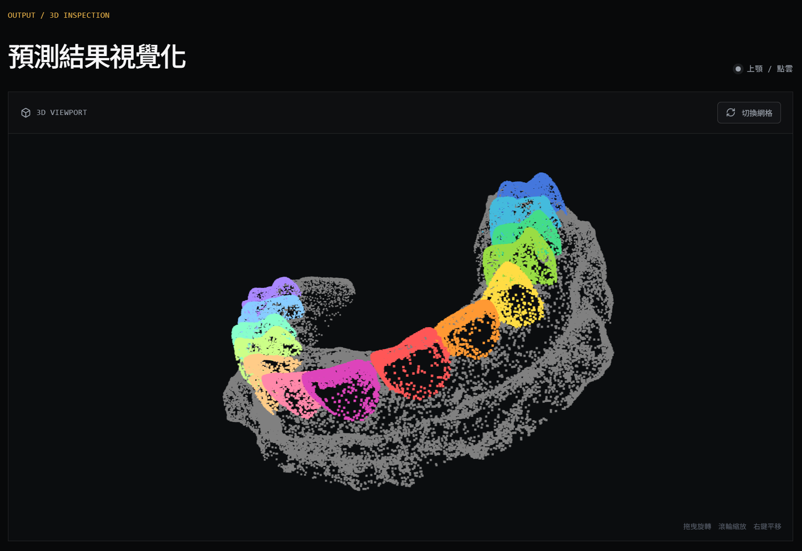
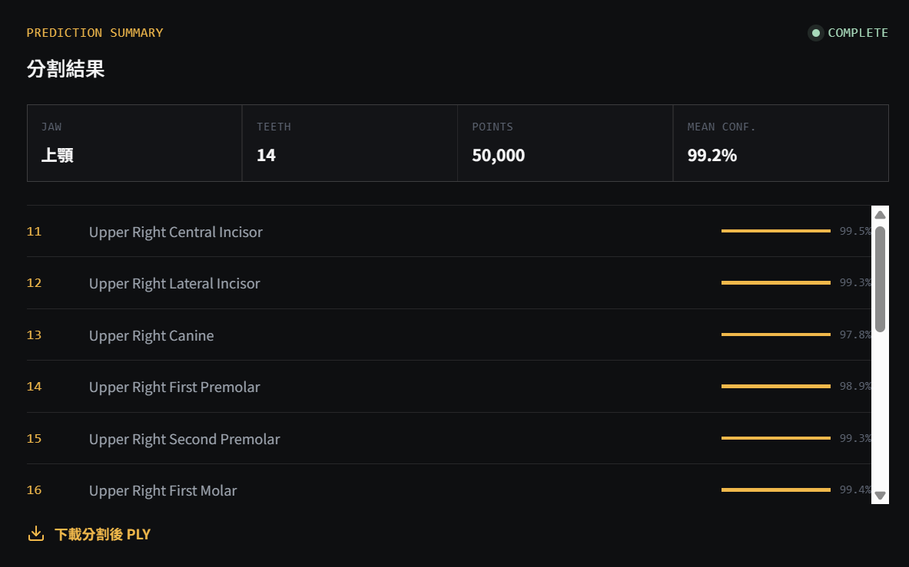

# Dental Point Cloud Viewer

Local-first React + Three.js interface for inspecting AI segmentation results from intraoral scans. The workbench is intentionally focused on one task: upload a 3D scan, run the local dental segmentation API, and inspect the predicted teeth in an interactive 3D viewport.

Backend and model pipeline: [YuriyLin/dental-point-cloud-segmentation](https://github.com/YuriyLin/dental-point-cloud-segmentation)

## What this demonstrates

- **3D product integration**：React / TypeScript frontend connected to a local FastAPI inference service.
- **Mesh and point-cloud visualization**：switch between a continuous labeled mesh and sampled prediction points.
- **Dental semantics**：display FDI tooth numbers, tooth names, detected count and per-result confidence.
- **Local privacy boundary**：scan files are sent only to the configured local API; no external vision API is required.
- **Portfolio-ready interaction**：drag to rotate, wheel to zoom, right-drag to pan, inspect output metadata and download the colored PLY.

## Screenshots

### Segmented mesh view



### Segmented point-cloud view



### Prediction summary



## User flow

```text
Choose scan
    ↓
Select upper / lower / auto jaw mode
    ↓
Run local segmentation API
    ↓
Review tooth count, FDI labels and confidence
    ↓
Switch mesh / point-cloud view
    ↓
Download colored PLY
```

## Features

### Input and inference

- Upload `.stl`, `.ply` or `.obj` files.
- Choose `upper`, `lower` or `auto` jaw mode.
- Show API health and model readiness before inference.
- Report loading, success and error states in the main workflow.

### 3D inspection

- Render labeled prediction points with Three.js.
- Render an optional labeled original-resolution mesh.
- Toggle between mesh and point-cloud presentation.
- Rotate, zoom and pan around the scan.
- View FDI tooth metadata and download the result.

### Important interpretation boundary

The displayed confidence is the model's prediction confidence, not segmentation accuracy. The companion backend has not yet published a ground-truth benchmark for the formal STL fixtures. The auto jaw classifier also misclassified the current formal lower fixture, so use the manual lower selector for that demonstration case.

The related internship work reported 98.19% mIoU, 98.91% Dice, 99.63% tooth identification accuracy and at least 97.15% IoU on the hardest 5% cases for a hierarchical 33-label pipeline: jaw classification followed by a 17-class model for the selected jaw. These historical figures are documented for portfolio context only; they have not been revalidated by this frontend or the current public API. See the [core repository evaluation notes](https://github.com/YuriyLin/dental-point-cloud-segmentation#historical-internship-results) for the reproducibility boundary.

## Local development

Requirements: Node.js 18+ and a running local backend.

```powershell
npm ci
Copy-Item .env.local.example .env.local
npm run dev
```

Open `http://localhost:3000`.

The `.env.local` file controls the backend URL:

```env
VITE_API_BASE_URL=http://localhost:8000
```

Start the backend by following the [core repository inference guide](https://github.com/YuriyLin/dental-point-cloud-segmentation/blob/main/INFERENCE_GUIDE.md).

## API contract

| Method | Endpoint | Purpose |
| --- | --- | --- |
| `GET` | `/api/health` | Show backend readiness |
| `POST` | `/api/upload` | Upload a scan |
| `POST` | `/api/segment/{task_id}` | Run segmentation with optional `jaw_type` |
| `GET` | `/api/metadata/{task_id}` | Read labels and colors |
| `GET` | `/api/download/{task_id}` | Download colored PLY |

The client-side API adapter lives in [`services/apiService.ts`](services/apiService.ts). The Three.js viewer lives in [`components/InteractiveViewer.tsx`](components/InteractiveViewer.tsx).

## Build

```powershell
npm run build
```

The production build is written to `dist/` and is ignored by Git.

## Repository structure

```text
dental-point-cloud-viewer/
├── components/
│   ├── AIDemo.tsx                 # Upload, jaw selection and result state
│   └── InteractiveViewer.tsx      # Three.js mesh / point-cloud viewer
├── services/apiService.ts         # FastAPI client and response types
├── hooks/                         # Viewer and metadata hooks
├── docs/screenshots/              # Portfolio screenshots
├── App.tsx                        # Workbench composition
├── app.css                        # Design tokens and responsive styles
└── README.md
```

## Scope and safety

This is a visualization and engineering demonstration, not a medical device or diagnostic tool. Do not use the displayed result for clinical decisions. Raw scans, model weights, local environment files and generated outputs are not part of this repository.

## License

This frontend currently does not declare a separate project license. Review the upstream and project-specific licensing terms before publishing a final license for redistribution.
